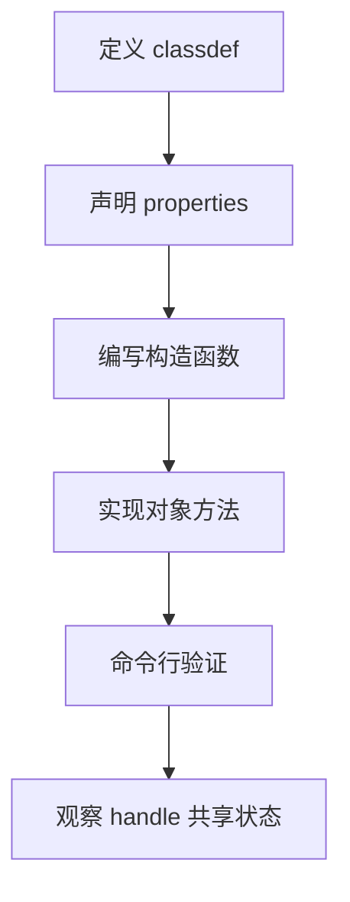

# CH00201：Point2D 入门

本节从最小可用的 MATLAB 类开始，重点理解类定义、属性、方法和句柄语义。

## 文件

- `Point2D.m`：二维点类，包含构造函数、模长、点间距离和平移方法。

## 快速运行

在 MATLAB 命令窗口执行：

```matlab
cd('CH002/CH00201')
p = Point2D(3, 4);
p.magnitude()             % 结果：5

q = Point2D(0, 0);
p.distanceTo(q)           % 结果：5

p.translate(1, -2);
[p.x, p.y]                % 结果：[4, 2]
```

## 核心知识

- `classdef Point2D < handle`：定义句柄类。
- `properties`：定义对象状态。
- `methods`：定义对象行为。
- 构造函数名称与类名相同。
- `hypot(x,y)` 比直接写 `sqrt(x^2+y^2)` 更适合计算二维模长。

## 句柄语义实验

```matlab
p = Point2D(1, 2);
alias = p;
alias.translate(10, 0);
[p.x, p.y]  % [11, 2]；两个变量引用同一个对象
```

## 练习

1. 添加 `setPosition(x,y)` 方法。
2. 添加 `toVector()` 方法，返回行向量 `[x, y]`。
3. 创建三个点，计算它们构成的折线总长度。
4. 把类定义改成不继承 `handle` 的值类，观察别名实验的结果。

## 学习流程



下一节在此基础上加入属性封装、输入检查与零向量边界处理。