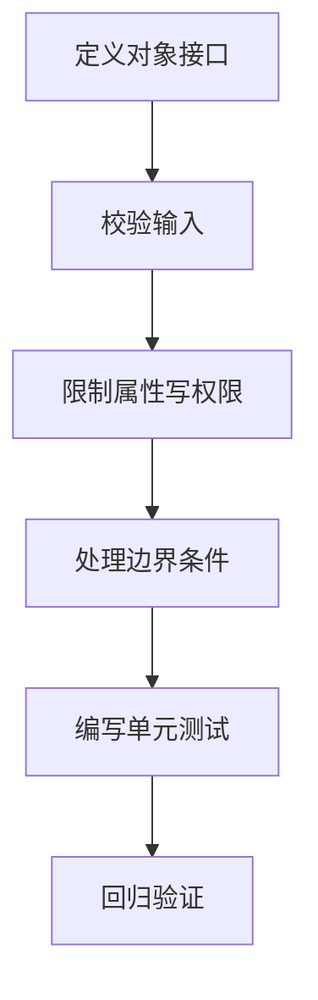

# CH00202：Point2D 封装与边界条件

本节把入门类改造成更稳健的对象接口：坐标只能通过类方法修改，输入必须是有限实数标量，并对零向量归一化进行明确处理。

## 文件

- `Point2D.m`：封装版句柄类。
- `Point2DTest.m`：基于 MATLAB Unit Test 的自动化测试。

## 快速运行

```matlab
cd('CH002/CH00202')
p = Point2D(3, 4);
p.magnitude()       % 5
p.normalize();
[p.x, p.y]          % [0.6, 0.8]

p.moveBy(1, 1);
[p.x, p.y]          % [1.6, 1.8]
```

属性使用 `SetAccess = private`，因此外部代码不能直接执行 `p.x = 10`。请通过 `moveBy` 等公开方法改变对象状态。

## 运行测试

```matlab
results = runtests('Point2DTest.m');
table(results)
```

请从本目录运行测试，避免同名的 `Point2D` 类被 MATLAB 路径中其他章节的版本覆盖。不同章节是逐步演进的独立示例，不建议同时加入 MATLAB path。

## 设计要点

1. **封装**：限制外部直接写入内部状态。
2. **输入契约**：坐标必须是有限实数标量。
3. **边界条件**：零向量不能归一化，使用稳定且可识别的错误标识符。
4. **可测试性**：正常行为与异常行为都要验证。
5. **句柄语义**：`moveBy` 和 `normalize` 都会原地修改同一个对象。

## 学习流程



## 练习

- 添加 `rotate(theta)`，绕原点旋转指定弧度。
- 为 `moveBy` 添加坐标溢出或无效输入测试。
- 讨论：如果改为值类，哪些方法应返回新对象，而不是原地修改？
- 将异常信息、输入约束和公开 API 写进类注释。