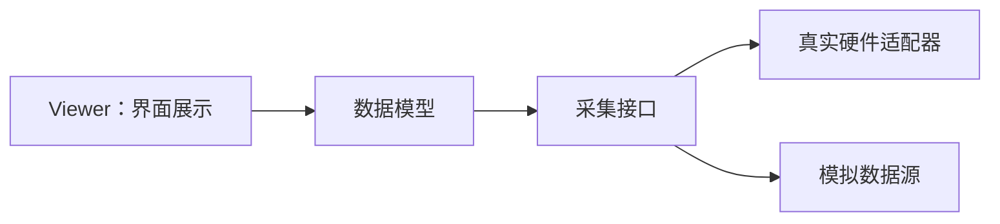

# CH00203：常量属性与基础 GUI 封装

本节通过 `A.m`、`Viewer.m` 和 `DataAcqusitionHardware.m` 学习常量属性、静态方法、GUI 句柄和兼容性边界。

## 1. 常量属性与静态方法

```matlab
A.R
A.degreesToRadians(90)  % pi/2
A.radiansToDegrees(pi)  % 180
```

- `R` 是度转换为弧度的比例常量。
- 静态方法属于类的行为，不需要先创建对象。
- 输入必须是有限实数；无效输入会抛出稳定的 `A:InvalidAngle` 错误。

## 2. Viewer 的最小实验

```matlab
v = Viewer();
v.setText('Hello MATLAB OOP');
disp(v.getText());
disp(isgraphics(v.hFig));  % 句柄可读取，但不可由外部重新赋值
delete(v);
```

`hFig` 和 `hEdit` 保留公开读取能力，但通过 `SetAccess = private` 限制外部改写；文本交互使用 `setText/getText`。对象删除时会关闭窗口。该示例使用传统的 `figure/uicontrol` API。

## 3. 硬件占位类的边界

`DataAcqusitionHardware` 保留旧有类名和缓冲区常量，但当前没有连接真实设备或读取数据的实现。不要将它误认为已经可用的硬件驱动。常量的单位及具体含义仍应由目标设备文档确认。

## 4. 运行测试

在本目录执行：

```matlab
results = runtests('A_Test.m');
table(results)
```

GUI 需要图形环境，适合手动运行 Viewer 示例；纯计算的角度换算测试不依赖 GUI。

## 分层关系



## 练习

1. 为 `Viewer` 增加清空文本的方法，但不要公开控件句柄的写权限。
2. 给常量换算方法添加矩阵输入测试。
3. 说明为什么硬件缓冲区常量不能替代真实设备读取代码。
