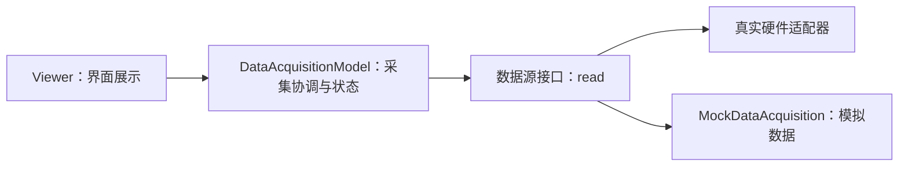

# CH00204：Dependent 属性、数据模型与 Viewer 解耦

本节把旧版 `Viewer` 改造成展示层，并通过构造函数注入 `DataAcquisitionModel`。模型负责调用数据源与保存结果，界面不直接访问硬件。

## 分层结构



## 快速运行

在 MATLAB 中将当前章节目录加入路径（不要同时添加其他章节含同名 `Viewer` 的目录）：

```matlab
source = MockDataAcquisition([10 20 30]);
model = DataAcquisitionModel(source);

model.acquire()
model.getLastData()
model.acquisitionCount

% 有图形界面时运行：
v = Viewer(model);
v.refresh();
v.text
delete(v);
```

数据模型本身不依赖 GUI，因此可以在无图形桌面环境中独立测试。示例数据源是模拟器，不代表已经连接任何真实设备。

## 关键设计

- **依赖注入：** `Viewer(model)` 接收模型，而不是自己创建或控制硬件。
- **Dependent 属性：** `text` 通过 getter/setter 映射到 GUI 控件。
- **可替换数据源：** 任何实现 `read()` 并返回有限数值向量的对象都可以接入模型。
- **边界检查：** 模型验证数据类型、实数性、有限性和向量形状。
- **兼容性：** 保留 `Viewer()` 无参构造方式；没有注入模型时调用 `refresh` 会给出明确错误。

## 测试

```matlab
results = runtests('DataAcquisitionModelTest.m');
table(results)
```

## 练习

1. 写一个从 MAT 文件读取数据的 source 类，接口仍然是 `read()`。
2. 为数据模型增加时间戳与采集状态。
3. 让 Viewer 支持格式化显示均值、最小值、最大值。
4. 讨论数据源返回空数组时应当视为有效数据还是采集故障，并用测试固定该契约。
