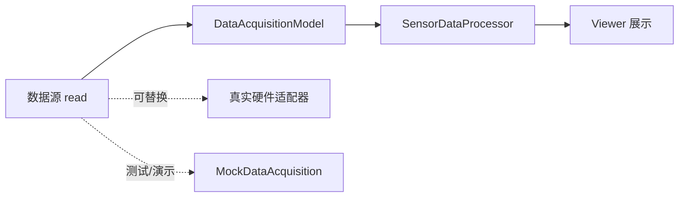

# CH00204：数据采集、处理与 Viewer 解耦

本节将采集源、数据模型、纯数据处理和 GUI 展示拆开。Viewer 不负责连接硬件；模型不负责绘图；处理器不依赖 GUI。

## 分层结构



## 快速运行：无 GUI

在本目录运行：

```matlab
source = MockDataAcquisition([10 20 30 40]);
model = DataAcquisitionModel(source);
samples = model.acquire();

summary = SensorDataProcessor.summarize(samples)
model.getLastData()
model.acquisitionCount
```

summary 包含 `count`、`mean`、`min`、`max` 和 `rms`。处理器是纯逻辑代码，可以单独测试，也可以在批处理脚本中复用。

## 完整 GUI 演示

在支持 MATLAB 图形界面的环境中运行：

```matlab
demoDecoupledViewer
```

演示数据流为：模拟源读取 → 模型保存采样 → 处理器计算统计量 → Viewer 显示文本。关闭窗口时会清理 Viewer 对象。

也可以手动运行：

```matlab
source = MockDataAcquisition([10 20 30]);
model = DataAcquisitionModel(source);
v = Viewer(model);
v.refresh();
v.text
delete(v);
```

## 自动化测试

在本目录运行：

```matlab
results = runtests('DataAcquisitionModelTest.m');
table(results)

results = runtests('SensorDataProcessorTest.m');
table(results)
```

模型测试覆盖正常采集、采集计数、无效数据源，以及数据源返回 NaN、复数和矩阵的错误分支。处理器测试覆盖行/列向量、统计结果和非法输入。

## 关键设计

- **依赖注入：** `Viewer(model)` 接收模型，不自行创建数据源。
- **单一职责：** `DataAcquisitionModel` 管理采集与状态；`SensorDataProcessor` 负责纯数据计算；`Viewer` 负责显示。
- **可替换数据源：** 数据源只需实现 `read()`，并返回非空、有限的实数向量。
- **边界检查：** 数据在模型和处理器边界分别验证，错误标识稳定。
- **兼容性：** 保留 `Viewer()` 无参构造；没有模型时调用 `refresh()` 会给出明确错误。
- **硬件边界：** `MockDataAcquisition` 只返回预设数据，不代表已连接真实设备。

## 练习

1. 编写 MAT 文件数据源，保持 `read()` 接口不变。
2. 为模型增加采集时间戳和状态字段。
3. 把均值、最值等扩展为可插拔处理策略。
4. 在目标 MATLAB 版本中执行测试，并手动检查 GUI 关闭和删除行为。
