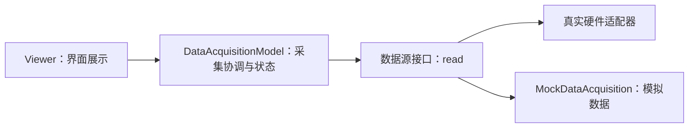

# CH00204：Dependent 属性、数据模型与 Viewer 解耦

本节把旧版 `Viewer` 改造成展示层，并通过构造函数注入 `DataAcquisitionModel`。模型负责调用数据源与保存结果，界面不直接访问硬件。

## 分层结构



## 快速运行：无 GUI 部分

在本目录运行：

```matlab
source = MockDataAcquisition([10 20 30]);
model = DataAcquisitionModel(source);

model.acquire()
model.getLastData()
model.acquisitionCount
```

数据模型本身不依赖 GUI，因此可以在无图形桌面环境中独立测试。

## 完整 GUI 演示

在支持 MATLAB 图形界面的环境中运行：

```matlab
demoDecoupledViewer
```

也可以手动执行：

```matlab
source = MockDataAcquisition([10 20 30]);
model = DataAcquisitionModel(source);
v = Viewer(model);
v.refresh();
v.text
delete(v);
```

模拟器只返回预设数据，不代表已经连接真实设备。

## 关键设计

- **依赖注入：** `Viewer(model)` 接收模型，而不是自己创建或控制硬件。
- **Dependent 属性：** `text` 通过 getter/setter 映射到 GUI 控件。
- **可替换数据源：** 任何实现 `read()` 并返回有限实数向量的标量对象都可以接入模型。
- **边界检查：** 模型使用稳定的错误标识检查数据源和采集值。
- **兼容性：** 保留 `Viewer()` 无参构造方式；没有注入模型时调用 `refresh` 会给出明确错误。

## 运行自动化测试

```matlab
results = runtests('DataAcquisitionModelTest.m');
table(results)
```

这些测试只覆盖模型和模拟数据源，不创建 GUI，因此适合自动化或无桌面环境。GUI 演示需要手动验证。

## 练习

1. 写一个从 MAT 文件读取数据的 source 类，接口仍然是 `read()`。
2. 为数据模型增加时间戳与采集状态。
3. 让 Viewer 支持格式化显示均值、最小值、最大值。
4. 为返回空数据或非有限数据的 source 编写测试，确认模型的错误契约。
