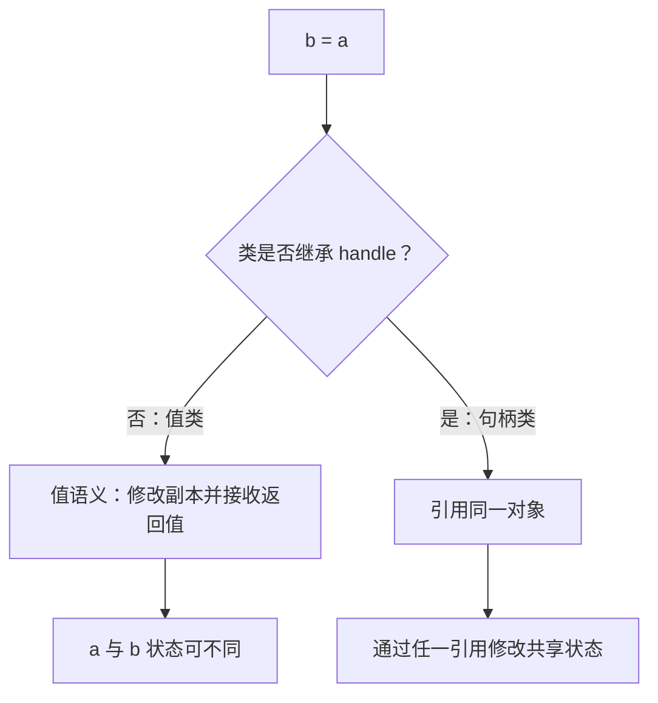

# CH00205：值类与句柄类对比实验

## 目标

用最小可运行示例理解 MATLAB 普通类（值语义）与继承 `handle` 的句柄类之间的赋值差异。

## 运行实验

```matlab
result = compareValueAndHandle()
```

预期输出的关键结果：

| 类型 | a.Count | b.Count | 原因 |
|---|---:|---:|---|
| ValueCounter | 0 | 1 | 修改后返回的新值赋给 b，a 保持原值 |
| HandleCounter | 1 | 1 | a 和 b 引用同一个对象 |

## 运行测试

```matlab
results = runtests('ValueHandleTest.m');
table(results)
```

## Mermaid 知识图



## 练习

1. 把 `ValueCounter.increment` 的返回值赋回 `b` 与不赋回进行比较。
2. 将句柄类的 `Count` 设置为私有，只允许通过方法增加计数。
3. 讨论大型数值数据、GUI 窗口和配置对象分别适合哪种语义。
