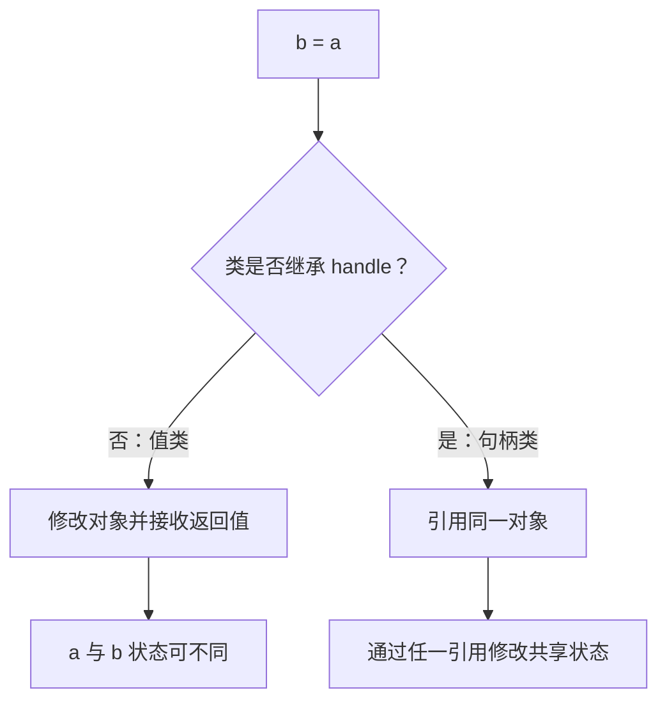

# CH00205：值类与句柄类对比实验

## 目标

用最小可运行示例理解 MATLAB 普通类（值语义）与继承 `handle` 的句柄类之间的赋值差异。

## 运行实验

```matlab
result = compareValueAndHandle()
```

预期结果：

| 类型 | a.Count | b.Count | 原因 |
|---|---:|---:|---|
| ValueCounter | 0 | 1 | 值类方法返回修改后的对象，必须把返回值赋回 b |
| HandleCounter | 1 | 1 | a 和 b 指向同一对象，方法直接修改共享状态 |

## 运行测试

```matlab
results = runtests('ValueHandleTest.m');
table(results)
```

## Mermaid 知识图



## 设计提醒

值类方法通常需要返回修改后的对象；句柄类方法可以原地修改对象状态。不要仅因为句柄类写起来方便就继承 `handle`：共享可变状态会让副作用更难追踪。
