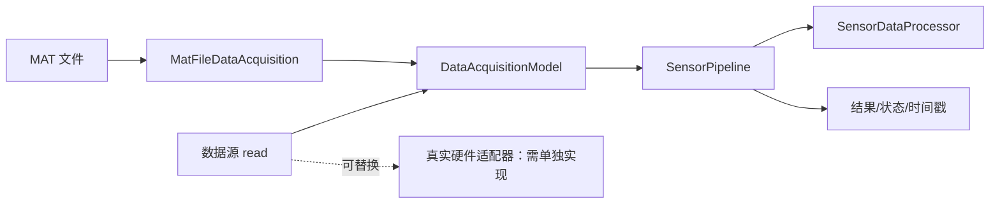

# CH00206：传感器采集处理工程流水线

本节将 CH00204 的采集模型与纯数据处理器组合成可测试的工程流水线，增加状态、时间戳、错误记录和最近一次成功结果保留。现在既可使用模拟数据，也可从 MAT 文件回放记录数据；示例不连接真实设备。

## 架构



## 运行前准备

将以下目录加入 MATLAB 路径：

- `CH002/CH00204`
- `CH002/CH00206`

模拟数据示例：

```matlab
result = demoSensorPipeline();
disp(result.summary);
```

MAT 文件回放示例：假设 MAT 文件中存在名为 `samples` 的数值向量。

```matlab
source = MatFileDataAcquisition('recordedSensorData.mat', 'samples');
model = DataAcquisitionModel(source);
pipeline = SensorPipeline(model);
result = pipeline.run();
disp(result.samples);
disp(result.summary);
```

`MatFileDataAcquisition` 只负责读取指定变量；有限实数向量的统一校验仍由 `DataAcquisitionModel` 完成。文件不存在或变量名不匹配时会抛出带有明确标识的异常。

## 状态与异常策略

- `idle`：尚未执行。
- `running`：正在执行采集和处理。
- `completed`：本次成功，更新结果和成功运行计数。
- `error`：发生异常，保存错误标识与消息，再把原异常抛给调用方。
- 失败不会覆盖 `lastResult`，成功计数也不会增加；调用方可以决定是否重试。
- 时间戳使用 MATLAB `datetime`，方便日志记录；它不是高精度实时调度保证。

## 自动化测试

在仓库根目录运行前，先加入相关路径：

```matlab
addpath('CH002/CH00204');
addpath('CH002/CH00206');

results = runtests('CH002/CH00206/SensorPipelineTest.m');
table(results)

results = runtests('CH002/CH00206/MatFileDataAcquisitionTest.m');
table(results)

% 端到端集成冒烟检查：会临时创建并清理 MAT 文件
integrationResult = testMatFilePipelineIntegration();
disp(integrationResult.summary);
```

测试覆盖流水线正常路径、结果统计、状态/时间戳、无效采样、最近成功结果保留，以及 MAT 文件读取、缺失变量、无效变量名和文件不存在等情况。

## 真实硬件适配原则

真实设备驱动应独立实现 `read()`，并处理设备初始化、超时、断连、资源释放和驱动特定异常。不要把串口、DAQ 或厂商 SDK 调用写进 `SensorPipeline`、`SensorDataProcessor` 或 `Viewer`。硬件适配器应先转换为有限实数向量，再交给现有模型。

## 后续练习

1. 为数据源定义超时和重试策略，并避免无限重试。
2. 将 `datetime` 时间戳与设备采样时间区分开。
3. 为处理器增加可配置的单位换算与限幅策略。
4. 在支持图形界面的 MATLAB 环境中，把流水线结果传给 `Viewer` 展示。
