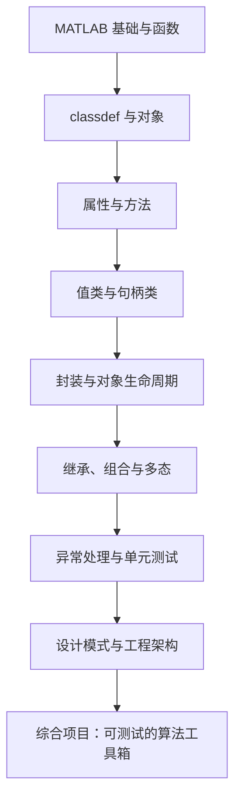

# MATLAB 面向对象编程（MatlabOOP）

> 目标：从理解 `classdef` 语法，进阶到设计可复用、可测试、可维护的 MATLAB 类，并能把面向对象方法用于数值计算、数据处理和工程仿真。

## 学习导航

- [学习目标与路线](#学习目标与路线)
- [仓库结构](#仓库结构)
- [核心知识清单](#核心知识清单)
- [循序渐进的实践项目](#循序渐进的实践项目)
- [代码规范与设计原则](#代码规范与设计原则)
- [测试与调试](#测试与调试)
- [每周学习计划](#每周学习计划)
- [学习检查表](#学习检查表)
- [参考资料](#参考资料)

## 学习目标与路线

完成学习后，应该能够：

1. 独立创建值类和句柄类，理解对象复制、共享引用及生命周期差异。
2. 正确使用属性验证、访问权限、常量属性、静态方法和构造函数。
3. 运用继承、组合、抽象类和方法重载组织复杂程序。
4. 将 GUI、数据采集、算法和数据模型解耦。
5. 使用 MATLAB 单元测试框架验证类的行为，并处理异常与边界条件。
6. 将类设计应用到信号处理、传感器数据、数值算法和工程仿真。



## 仓库结构

| 路径 | 学习任务 |
| --- | --- |
| [CH002/CH00201](CH002/CH00201/README.md) | Point2D 入门：类定义、属性、构造函数和句柄语义 |
| [CH002/CH00202](CH002/CH00202/README.md) | Point2D 封装：输入校验、边界条件和单元测试 |
| `CH002/CH00203` | 常量属性、句柄对象、Viewer 与数据采集类 |
| `CH002/CH00204` | Dependent 属性与 GUI 组件封装 |
| [完整学习计划](docs/STUDY_PLAN.md) | 7 阶段学习任务、验收标准与复盘模板 |

**注意：** 不同章节可能存在同名的 `Point2D` 类。学习某一节时，请只将对应章节加入 MATLAB path，避免 MATLAB 调用到其他章节的同名类。

## 核心知识清单

### 1. 类与对象

- `classdef ClassName`：类定义的基本结构。
- 属性（`properties`）描述对象状态；方法（`methods`）描述对象行为。
- 构造函数通常与类同名，负责建立有效对象。
- 句柄类通过 `< handle` 声明；普通类是值类。
- 对象数组、对象比较、复制语义和对象销毁。

练习：实现 `Point2D`，支持构造、平移、距离计算和字符串显示；为非法输入定义明确行为。

### 2. 属性设计与封装

- `Constant`、`Dependent`、`Transient` 属性。
- `SetAccess`、`GetAccess`、`properties (Access = private)`。
- 属性默认值、属性验证（根据 MATLAB 版本选择合适语法）。
- 使用方法维护不变量，不让外部代码随意破坏对象状态。

练习：实现一个带只读标识、可验证采样率和私有缓存的 `SignalBuffer` 类。

### 3. 方法类型

- 普通实例方法与构造函数。
- `Static` 静态方法：不依赖某个对象实例的操作。
- `Dependent` 属性的 getter/setter。
- 可变输入输出、参数检查和错误标识。
- 方法重载：明确不同输入类型或对象类型下的行为。

### 4. 值类与句柄类

| 对比项 | 值类 | 句柄类 |
| --- | --- | --- |
| 赋值行为 | 通常表现为值语义，修改副本不影响原对象 | 变量通常引用同一对象，修改可被其他引用观察到 |
| 适用场景 | 几何数据、配置快照、不可变数据模型 | GUI、设备会话、共享缓存、状态管理对象 |
| 设计注意 | 避免无意复制大型数据 | 明确共享状态、资源释放和对象生命周期 |

练习：分别创建值类和句柄类，执行 `b = a` 后修改 `b`，观察 `a` 的变化，并解释原因。

### 5. 继承、组合与多态

- `classdef Child < Parent`：继承公共接口和行为。
- 方法重写、访问权限与构造顺序。
- 抽象类与抽象方法（按目标 MATLAB 版本核对语法）。
- 组合优先：让对象持有其他对象，而不是把所有功能堆进继承树。
- 面向接口编程：调用稳定的方法约定，而非依赖具体实现细节。

练习：设计 `Sensor` 基类或接口约定，并实现 `TemperatureSensor` 与 `PressureSensor`；由统一采集器调用其读取方法。

### 6. 事件、回调与 GUI

- 句柄对象、事件定义与监听器。
- GUI 回调函数与对象方法之间的关系。
- 将界面展示、业务逻辑、数据存储分开。
- 避免在 GUI 类中直接塞入复杂算法。

练习：改造 `Viewer` 示例，让界面只负责输入输出，数据处理委托给独立模型类。

### 7. 工程化能力

- 输入参数校验与异常处理。
- 单元测试、边界测试和回归测试。
- 文档注释、示例脚本和版本兼容说明。
- 性能分析：先用 profiler 找到瓶颈，再优化。
- 依赖注入与组合：让算法能够在不连接真实硬件的情况下测试。

## 循序渐进的实践项目

### 项目 A：二维几何对象

实现 `Point2D` 和 `Line2D`：

- 支持构造、平移、距离、长度和输入校验。
- 区分对象状态与计算结果。
- 为零长度线段、空输入和非法类型添加测试。

验收标准：示例能运行；接口有注释；边界条件有测试。

### 项目 B：传感器数据模型

实现 `SensorData`、`Sensor` 和 `SensorRecorder`：

- 统一时间戳、采样值、单位和有效性标记。
- 采集接口与真实硬件解耦，使用模拟传感器进行测试。
- 对丢帧、无效值和采样率不一致定义处理策略。

### 项目 C：数据采集与 Viewer 解耦

结合仓库已有的 `DataAcqusitionHardware`、`Viewer` 示例：

- 明确硬件层、数据模型层、界面层的职责。
- 不让界面直接操作底层硬件细节。
- 使用模拟数据验证显示、刷新和错误提示。
- 对资源打开/关闭及异常路径进行检查。

### 项目 D：算法类工具箱

实现一个可复用的信号处理类：

- 输入：采样数据、采样率和算法参数。
- 输出：处理结果、状态信息和必要的诊断信息。
- 算法实现与绘图、文件读写分离。
- 用固定测试数据验证正常情况、边界情况和异常输入。

### 项目 E：小型工程仿真

将传感器、滤波器、记录器和可视化器组合成完整应用。要求可以替换传感器实现、独立测试算法，并通过配置切换参数。

## 代码规范与设计原则

1. **一个类聚焦一个主要职责**：避免把采集、算法、绘图和文件存储写在同一个类里。
2. **显式验证输入**：对尺寸、类型、范围、单位和空值作出清晰约定。
3. **谨慎使用句柄类**：只有在确实需要共享可变状态或对象身份时才继承 `handle`。
4. **减少公开可写属性**：通过方法控制状态变化，保护对象不变量。
5. **组合优先于深层继承**：可替换、可测试通常比复杂继承关系更重要。
6. **错误要可定位**：使用稳定、可读的错误标识与消息。
7. **示例可重复运行**：示例应说明前置条件、运行方式和预期结果。
8. **标注版本差异**：属性验证、GUI API 等特性应注明最低 MATLAB 版本或替代方案。

## 测试与调试

建议为每个类建立独立测试文件，使用 MATLAB 的 `matlab.unittest` 框架。

测试维度：

- 正常输入：对象按预期创建，方法返回正确结果。
- 边界输入：零值、空数组、极大/极小值、边界尺寸。
- 非法输入：类型错误、维度不匹配、越界参数。
- 状态语义：值类复制与句柄类共享引用是否符合设计。
- 依赖隔离：算法能否在没有真实硬件、GUI 或网络连接的情况下测试。
- 回归测试：修改实现后，既有行为仍然正确。

```matlab
% 在项目根目录下执行
results = runtests;
table(results)
```

如果测试位于专用目录，可根据项目结构调整测试发现路径。提交前请在目标 MATLAB 版本中实际运行示例和测试。

## 每周学习计划

| 周次 | 学习重点 | 必须完成的成果 |
| --- | --- | --- |
| 第 1 周 | 类、对象、属性、方法、构造函数 | 完成 Point2D |
| 第 2 周 | 值类、句柄类、封装、属性访问控制 | 编写赋值语义对比实验 |
| 第 3 周 | 静态方法、Dependent 属性、异常处理 | 完成 SignalBuffer |
| 第 4 周 | 继承、重写、抽象、组合与多态 | 完成多种传感器模型 |
| 第 5 周 | GUI、回调、事件、硬件抽象 | 解耦 Viewer 与数据模型 |
| 第 6 周 | 单元测试、性能分析、文档 | 为核心类补齐测试与示例 |
| 第 7 周 | 综合项目与重构 | 完成可替换、可测试的算法工具箱 |

## 学习检查表

- [ ] 能不看资料写出一个完整的 `classdef` 类。
- [ ] 能解释值类与句柄类的赋值差异。
- [ ] 能设计属性访问权限并保护对象状态。
- [ ] 能区分实例方法、静态方法和属性访问方法。
- [ ] 能合理使用继承、组合和方法重写。
- [ ] 能将 GUI、算法、数据和硬件访问分层。
- [ ] 能用单元测试覆盖正常、边界和异常场景。
- [ ] 能说明关键设计选择、版本要求和运行步骤。

## 参考资料

- [MATLAB 面向对象编程官方文档](https://www.mathworks.com/help/matlab/object-oriented-programming.html)
- [MATLAB 类定义（classdef）](https://www.mathworks.com/help/matlab/ref/classdef.html)
- [MATLAB 单元测试框架](https://www.mathworks.com/help/matlab/matlab-unit-test-framework.html)

## 贡献与后续完善建议

新增章节时，建议每个主题都包含：

1. 学习目标与核心概念。
2. 可独立运行的最小示例。
3. 逐步练习与参考答案。
4. 常见错误与调试方法。
5. 单元测试和验收标准。
6. Mermaid 知识结构图（保持语法简单，便于 GitHub 渲染）。

建议后续按顺序补齐：基础语法示例说明 → 值类与句柄类对比 → 封装与继承 → 组合与设计模式 → 测试工程化 → 综合项目。
