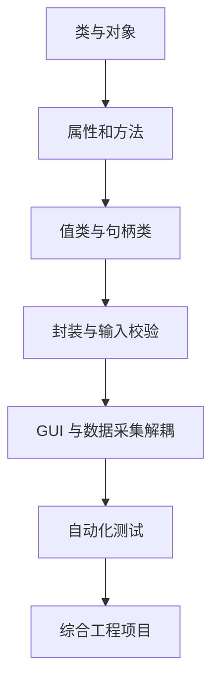

# MATLAB 面向对象编程（MatlabOOP）

本仓库从 MATLAB `classdef` 基础开始，逐步学习对象语义、封装、GUI、硬件抽象和可测试的工程设计。

## 学习路线



## 章节导航

| 路径 | 内容 |
|---|---|
| [CH00201](CH002/CH00201/README.md) | Point2D 入门：构造函数、属性、方法和句柄语义 |
| [CH00202](CH002/CH00202/README.md) | Point2D 封装：访问控制、输入验证、边界条件与单元测试 |
| [CH00203](CH002/CH00203/README.md) | 常量属性、静态方法、GUI 句柄与硬件占位类 |
| [CH00204](CH002/CH00204/README.md) | 数据源、采集模型、纯数据处理、Viewer 解耦与单元测试 |
| [CH00205](CH002/CH00205/README.md) | 值类与句柄类的赋值语义对比实验 |
| [CH00206](CH002/CH00206/README.md) | 采集、处理、状态管理、MAT 文件回放与异常处理 |
| [分阶段学习计划](docs/STUDY_PLAN.md) | 7 阶段学习任务、验收标准与复盘模板 |

## 推荐练习顺序

1. 阅读每章 README，先运行最小示例。
2. 观察对象属性如何变化，并主动修改参数。
3. 阅读测试文件，分别理解正常路径和异常路径。
4. 完成练习后再阅读下一章。
5. 学习 GUI 示例时区分界面、数据模型与设备接口。

## 自动化测试

MATLAB 具备 `matlab.unittest` 单元测试框架。建议每次只把当前章节目录加入路径，尤其注意不同章节可能包含同名的 `Point2D` 或 `Viewer` 类。

在相应章节目录中运行：

```matlab
% CH00201/CH00202：按各自 README 运行示例和测试
results = runtests;
table(results)
```

CH00203 的角度转换测试不需要 GUI。CH00204 的数据模型测试只使用模拟数据源，不创建窗口；`demoDecoupledViewer` 需要可用的图形环境。CH00206 同时提供模拟数据和 MAT 文件回放适配器，具体测试命令见该章 README。提交前应在目标 MATLAB 版本中实际运行测试。

## 重要边界说明

- `DataAcqusitionHardware` 保留历史拼写以免破坏已有示例，但目前只是常量占位类，不会连接真实硬件。
- `MockDataAcquisition` 是用于开发和测试的模拟数据源，不代表设备驱动。
- `MatFileDataAcquisition` 用于回放 MAT 文件中的已记录数据，也不代表实时硬件接口。
- 值类方法与句柄类方法的状态修改方式不同；请查看 CH00205 的实验，不要仅为了方便而继承 `handle`。

## 参考资料

- [MATLAB 面向对象编程](https://www.mathworks.com/help/matlab/object-oriented-programming.html)
- [classdef 参考](https://www.mathworks.com/help/matlab/ref/classdef.html)
- [MATLAB 单元测试框架](https://www.mathworks.com/help/matlab/matlab-unit-test-framework.html)
