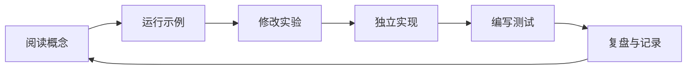

# MATLAB OOP 分阶段学习计划

本文配合仓库根目录 README 使用。建议每个阶段按“理解概念 → 阅读现有示例 → 独立编码 → 编写测试 → 总结设计决策”的顺序完成。

## 学习闭环

## 阶段一：读懂最小类

**目标：** 能读懂 `classdef`、属性、方法和构造函数。

任务：
- 阅读 `CH002/CH00201`、`CH002/CH00202` 下的 `Point2D` 示例。
- 创建对象，读取和修改属性，调用实例方法。
- 为二维点添加平移、距离和显示功能。

自测问题：
1. 类、对象、属性和方法分别解决什么问题？
2. 构造函数什么时候执行？
3. 如果两个对象的属性值相同，它们一定是同一个对象吗？

验收：从空文件开始独立写出可运行的 `Point2D` 类，并提供 3 个使用示例。

## 阶段二：理解值语义与句柄语义

**目标：** 理解 MATLAB 值类与 `handle` 类在赋值和修改时的区别。

任务：
- 分别实现 `ValueCounter` 和 `HandleCounter`。
- 执行 `b = a`，再修改 `b`，观察 `a` 的状态。
- 写下适合值类与句柄类的场景。

验收：提供可重复运行的对比脚本，并说明共享状态可能带来的副作用。

## 阶段三：封装与对象不变量

**目标：** 让对象始终处于有效状态。

任务：
- 将内部状态设为私有或限制写权限。
- 在构造函数和 setter 中检查输入类型、尺寸与范围。
- 为无效采样率、空数据、错误维度设计清晰的报错行为。

验收：非法输入不能悄悄破坏对象状态；错误消息能帮助定位问题。

## 阶段四：继承、组合与多态

**目标：** 根据需求选择继承还是组合。

任务：
- 设计统一的传感器读取接口。
- 实现模拟温度传感器和压力传感器。
- 让采集器通过统一接口读取数据，不依赖具体传感器类名。
- 再用组合方式替换一个内部实现，比较两种设计。

验收：新增一种传感器时，不需要重写采集器的核心流程。

## 阶段五：GUI 与硬件抽象

**目标：** 理解界面、业务逻辑和设备访问的职责边界。

任务：
- 阅读仓库中的 `Viewer` 和 `DataAcqusitionHardware`。
- 画出界面层、数据模型层、硬件适配层之间的依赖图。
- 让界面通过模型对象获取数据。
- 创建模拟硬件，在没有真实设备的情况下运行测试。

验收：硬件不可用时，仍可用模拟数据验证主要业务流程。

## 阶段六：单元测试与异常路径

**目标：** 用自动化测试保护类的行为。

任务：
- 使用 `matlab.unittest.TestCase` 为核心类编写测试。
- 覆盖正常输入、边界值、非法输入和状态变化。
- 对文件、设备等外部依赖使用替身或模拟对象。
- 记录测试运行方式和 MATLAB 版本要求。

验收：测试可以重复运行；失败时能明确指出哪个行为不符合预期。

## 阶段七：综合项目

实现一个可测试的传感器数据处理工具：

- `Sensor`：统一读取接口。
- `MockSensor`：生成可控的模拟数据。
- `SensorRecorder`：记录时间戳、数据和状态。
- `SignalProcessor`：处理数据，不负责 GUI 和硬件访问。
- `DataViewer`：显示结果，不直接实现算法。
- `Test*`：覆盖核心逻辑和异常场景。

验收标准：
- 每个类有清晰且单一的职责。
- 算法可独立测试。
- 传感器可替换。
- 输入、输出和错误行为有文档。
- 提供一份从启动到查看结果的完整示例。

## 每次学习记录模板

复制以下模板记录到个人笔记：

- **今天学习的概念：**
- **对应源码路径：**
- **我运行了什么：**
- **我修改了什么：**
- **遇到的问题与原因：**
- **关键代码与设计理由：**
- **还没理解的问题：**
- **下一步行动：**

## 复盘标准

不要只以“代码运行成功”作为完成标准。每个主题至少回答：

1. 这个设计解决了什么问题？
2. 是否有更简单的实现？
3. 对象状态可能在什么情况下变得无效？
4. 如何自动验证它的行为？
5. 如果未来增加一种实现，现有代码需要改多少？
